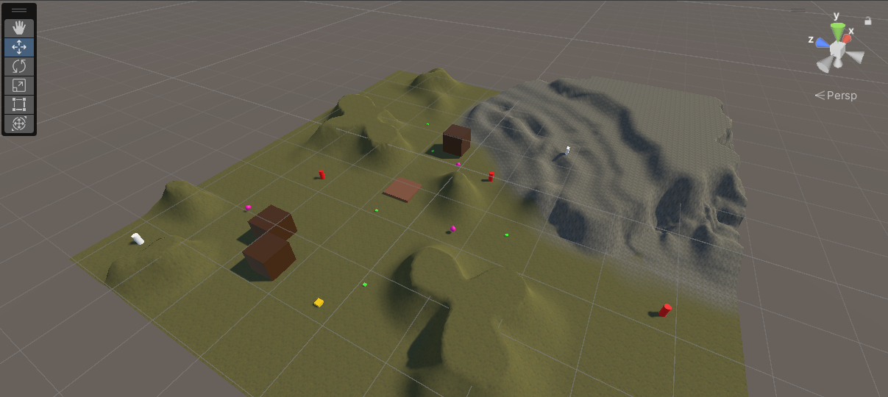
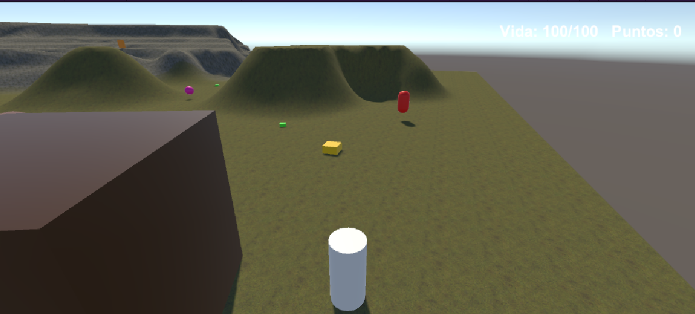

# Metal Gear Solid: Ghost Infiltration · Prototipo

**Trabajo Práctico Nº 2** de *Programación de Videojuegos I* (TUDIVJ, Facultad de Ingeniería, UNJu)

**Desarrolladora:** Esmeralda González Tolay · **LU:** TUV000821

**Versión de Unity:** 2022.3.31f1



## Descripción del juego

Prototipo 3D de infiltración y acción sci-fi pedido por *CubeGame Studios*. El jugador entra a una instalación modelada con el **Terrain Tool** de Unity, con colinas, un valle y una plataforma elevada a la que se llega por una rampa. Allí hay una **terminal de datos**.

**Objetivo:** recolectar ítems de datos distribuidos por el mapa (10 puntos cada uno), llegar a la terminal sobre la rampa y activarla con **E**. La terminal solo da acceso si el jugador reunió al menos **30 puntos**.

**Peligros:** drones centinela que patrullan el área y persiguen al jugador al detectarlo. Si lo tocan, le restan salud. Con 0 de vida, la partida termina en derrota. También hay una zona de barro que ralentiza y un generador que suma refuerzos enemigos cada cierto tiempo.

**Ayudas:** un ítem de invisibilidad que vuelve al jugador indetectable para los drones durante un tiempo.

## Guía de controles

| Tecla | Acción |
|---|---|
| **W A S D** | Mover al personaje (relativo a la cámara) |
| **Espacio** | Saltar |
| **Flechas** | Girar la cámara (izquierda y derecha) y subirla o bajarla (arriba y abajo) |
| **E** | Interactuar con la terminal (hay que mirarla de frente, a menos de 3 unidades) |
| **ENTER** | Comenzar la partida desde la pantalla de inicio |
| **P** o **ESC** | Pausar y continuar |
| **R** | Reiniciar tras la victoria o la derrota |

## Requisitos obligatorios

| Requisito | Implementación | Scripts |
|---|---|---|
| 1. Raycast + LayerMask | Chequeo de suelo con un rayo desde los pies filtrado por la capa `Ground`; interacción a distancia con un Raycast frontal filtrado por la capa `Interactable` | `PlayerMovement`, `PlayerInteraction`, `Terminal`, `IInteractable` |
| 2. NavMesh e IA | NavMesh horneado sobre el terreno. Dron centinela con `NavMeshAgent` que patrulla puntos al azar de un área y persigue al jugador al verlo | `SentinelAI` |
| 3. Salud, daño y puntuación | El jugador tiene 100 de vida y pierde 10 al tocar a un dron. Los ítems de datos suman puntos | `PlayerHealth`, `SentinelAI`, `DataItem` |
| 4. GameManager | Estados Start, Playing, Paused, Victory y GameOver. La pausa congela el tiempo con `Time.timeScale`. Informa por consola cada cambio de estado, la vida y el puntaje | `GameManager` |
| 5. Terreno | Escenario modelado con Terrain Tool: desniveles, una rampa y tres texturas | `Assets/Terrain` |

### Detalles técnicos

- **Raycast de suelo:** `Physics.Raycast` hacia abajo desde los pies del jugador, solo contra la capa `Ground`. El salto solo se permite si el rayo golpea suelo.
- **Raycast de interacción:** `Physics.Raycast` hacia adelante con alcance de 3 unidades, solo contra la capa `Interactable`. Muestra el aviso "E · Usar terminal" al apuntar.
- **Centinela:** radio de detección de 10 unidades con ángulo de visión de 120 grados y comprobación de línea de visión por Raycast (el terreno bloquea la vista). Pierde al jugador a las 14 unidades o si es invisible. Patrulla a velocidad 2 y persigue a 4.5, un poco menos que la velocidad del jugador (5).
- **Eventos:** `PlayerHealth` avisa con eventos (`OnHealthChanged` y `OnDied`) y el `GameManager` reacciona. El jugador no contiene la lógica de estado del juego.
- **Movimiento:** patrón *Strategy* (`IMovementStrategy`, con `SmoothMovement` y `AccelerateMovement`) sobre un `Rigidbody`.

## Detalle de opcionales elegidos

### Opción B · Power-Up de invisibilidad

Ítem recolectable que vuelve al jugador **indetectable para la IA durante 8 segundos**. El jugador se ve celeste mientras dura el efecto y aparece el aviso "INVISIBLE" con la cuenta regresiva.

- **Scripts:** `InvisibilityPowerUp.cs` y la propiedad `PlayerStats.Invisible` en `IMovementStrategy.cs`.
- **Cómo funciona:** al tocar el ítem, una **corrutina** pone `Stats.Invisible = true`, espera la duración con `WaitForSeconds` y lo restablece. `SentinelAI` consulta ese valor: si es verdadero, no detecta al jugador y los que lo perseguían vuelven a patrullar.

### Opción D · Zona de desaceleración (barro)

Áreas delimitadas que reducen la velocidad del jugador al **40%** mientras permanece dentro, y la restablecen al salir.

- **Script:** `MudZone.cs`.
- **Cómo funciona:** el Collider es un Trigger. `OnTriggerEnter` baja `Stats.Velocity` y `OnTriggerExit` llama a `Stats.ResetVelocity()`. Mientras el jugador está dentro se muestra el aviso "Barro: velocidad reducida".

### Opción E · Spawner de enemigos temporizado

Punto del mapa que instancia drones centinela cada 10 segundos, con un máximo de 3 vivos a la vez.

- **Script:** `EnemySpawner.cs`.
- **Cómo funciona:** `InvokeRepeating` llama a `SpawnEnemy()` (primer dron a los 5 segundos). Cada dron se genera sobre el NavMesh con `NavMesh.SamplePosition`, y si no hay NavMesh cerca no se genera y se avisa por consola. El tope de drones evita la acumulación.

## Capturas

### Pantalla Inicio


### Sentinelas


### Persecución de un dron


### PowerUp Invisibilidad


### Victoria


### Derrota


## Cómo abrir y ejecutar el proyecto

1. Clonar el repositorio:
   ```bash
   git clone https://github.com/LilEsme87/TP2_PVJ1.git
   ```
2. En **Unity Hub**: *Add > Add project from disk* y seleccionar la carpeta clonada.
3. Abrir el proyecto con **Unity 2022.3.31f1**.
4. Abrir la escena `Assets/Scenes/SampleScene`.
5. Presionar **Play** y, en la pantalla de inicio, **ENTER**.

Si el NavMesh no se ve en la escena, se puede volver a hornear desde *Window > AI > Navigation > Bake*.

## Estructura del proyecto

```
Assets/
  Materials/   Materiales de objetos y zonas
  Prefabs/     Prefab del dron centinela
  Scenes/      SampleScene (escena principal) y su NavMesh
  Scripts/     Scripts en C#
  Terrain/     Datos del terreno y capas de textura
  Textures/    Texturas del terreno
Packages/
ProjectSettings/
Screenshots/   Capturas usadas en este README
```

El archivo `.gitignore` excluye las carpetas autogeneradas de Unity (`Library/`, `Temp/`, `Logs/`, etc.).